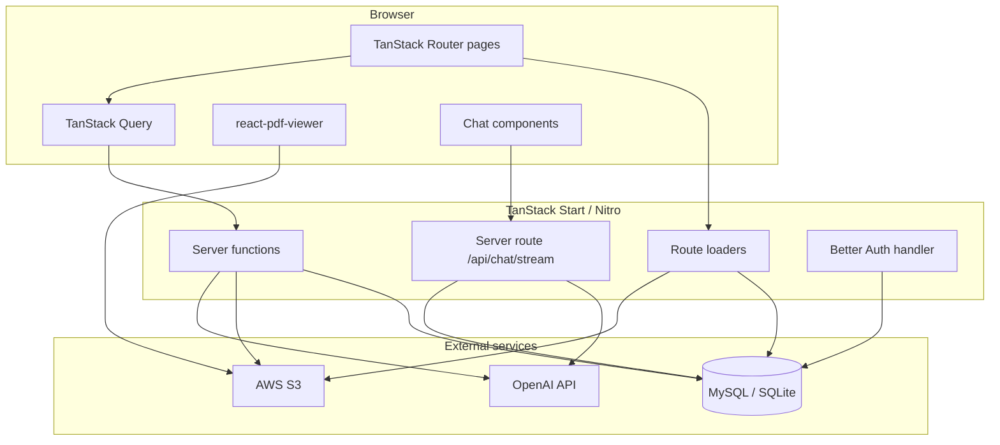
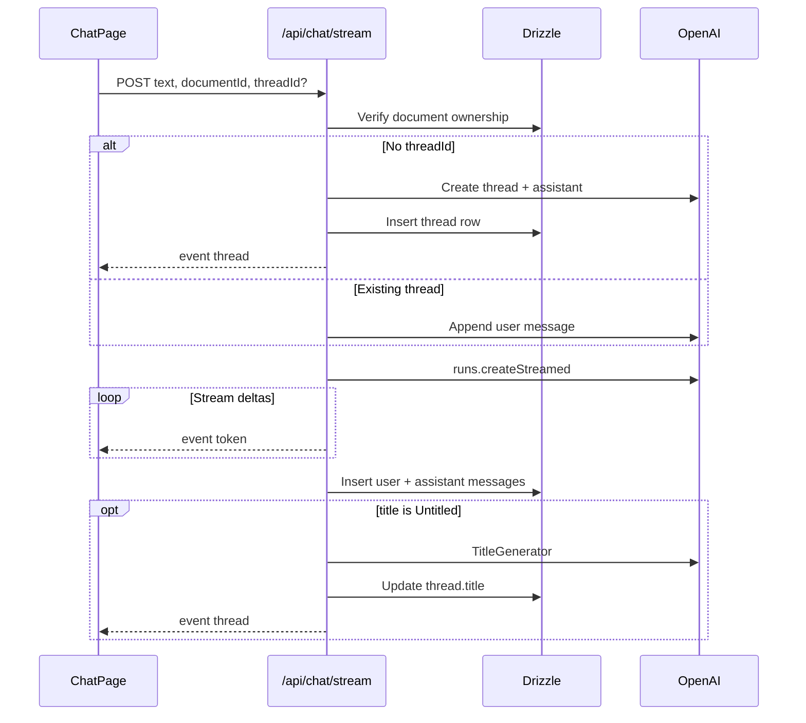

# Laravel to TanStack Start Migration - Plan

## Goal Capsule

- **Objective:** Replace the PDFPintar Laravel + Livewire + Svelte stack with a single TanStack Start (React 19, SSR, server functions) application while preserving user-facing behavior, the existing database schema, and OpenAI/S3 integrations.
- **Authority:** This plan is the implementation contract. Repo conventions and user preferences override PR sequencing hints. Stop on blockers that change scope or contradict a KTD — do not guess.
- **Execution profile:** Phased by U-ID dependency order. Chat streaming (U9) is the highest-risk unit; add integration coverage before modifying stream behavior.
- **Stop conditions:** MVP parity per Definition of Done, Verification Contract gates green, Laravel app archived under `legacy/laravel/`.
- **Tail ownership:** Implementer removes abandoned experimental code before declaring done.

## Product Contract

### Summary

Full rewrite of PDFPintar to TanStack Start at the repo root, archiving Laravel to `legacy/laravel/`. MVP covers auth, document CRUD, streaming PDF chat, public sharing, profile, markdown-to-PDF, and EN/ID i18n. Filament admin, Horizon, Pulse, backups, and the support bubble are deferred.

### Problem Frame

PDFPintar is a PDF chat application. Today it runs on Laravel 11 with Livewire 3, Volt auth pages, a custom Svelte bridge (`app/Support/Svelte.php`, `resources/js/mingle.svelte.js`), and a React island for the PDF viewer. Core product flows — upload to OpenAI + S3, Assistants API streaming chat, presigned PDF viewing, and public share links — are spread across PHP controllers, Livewire components, and Svelte clients. The hybrid UI stack increases maintenance cost and blocks a unified React runtime. A TanStack Start rewrite consolidates server and client on Node while reusing the existing MySQL/SQLite schema and external services.

### Requirements

#### Core product

- R0. Visitors see a marketing welcome page at `/` with navigation to auth and product overview (parity with `resources/views/welcome.blade.php`).
- R1. Authenticated users can register, log in, log out, reset password, and optionally verify email when `REQUIRE_EMAIL_VERIFICATION` is enabled.
- R2. Users can sign in with Google via Better Auth's Google provider; existing accounts match on `email` or `google_id`.
- R3. Authenticated users see a dashboard listing their documents with search and can upload PDFs (max 10MB), delete owned documents, and open a document chat page.
- R4. Document chat shows a split view: streaming assistant replies and a PDF viewer using a presigned S3 URL (5-minute TTL).
- R5. Chat streaming uses the existing SSE event envelope `{ type: 'token' | 'thread' | 'notice', data }` compatible with `app/Http/ChatEvent.php`.
- R6. First message on a document creates an OpenAI thread, assistant with `file_search`, and local `threads` row; subsequent messages append to the selected thread.
- R7. Messages persist after the stream completes (user + assistant pair); untitled threads receive an auto-generated title via OpenAI (port `app/Support/TitleGenerator.php`).
- R8. Document owners can toggle public/private sharing, generating a `sharing_token` when first shared.
- R9. Unauthenticated visitors can open `/share/{token}` for public documents and view read-only chat history plus the PDF.
- R10. Authenticated users can copy a public document into their library (S3 copy + new `documents` row).
- R11. Users can update profile name/email/password and delete their account.
- R12. Users can convert markdown to PDF at `/pdf-generator` (behavioral parity with `app/Livewire/MarkdownConverter.php`).
- R13. UI supports English and Indonesian using strings from `resources/lang/id.json` and a locale switcher (cookie-based).

#### Non-functional

- R14. Authorization mirrors `app/Policies/DocumentPolicy.php` — owner-only mutations; public read when `is_public && sharing_token`.
- R15. Document delete cascades threads and messages (mirror `app/Models/Document.php` boot hook).
- R16. AGPL license in `LICENSE` is preserved; README documents the new stack.

### Scope Boundaries

**In scope:** All R1–R16 requirements; TanStack Start app at repo root; Drizzle ORM; Better Auth; Vitest integration tests for stream/upload/auth; Playwright E2E for critical flows.

**Deferred for later**

- Filament admin panel parity (`/admin` CRUD for users, documents, threads)
- Horizon job dashboard, Laravel Pulse metrics, Spatie backup commands
- Support bubble widget (`spatie/laravel-support-bubble`)
- Chat message export to Excel/Word (commented out in Svelte today)
- Minimal super-admin route gated by `SUPER_ADMIN_EMAIL`

**Outside this product's identity**

- Rebuilding ops tooling (Horizon/Pulse) inside TanStack — use external observability instead when needed.

#### Deferred to Follow-Up Work

- Phase 7 minimal admin if ops pain warrants it
- Firebase client SDK removal after Google OAuth migration is verified in production

### Key Flows

- F1. Upload and chat
  - **Trigger:** User uploads PDF from dashboard.
  - **Actors:** Authenticated user.
  - **Steps:** Validate PDF → OpenAI file upload → S3 private store → create `documents` row → user opens document → sends message → SSE stream → persist messages.
  - **Outcome:** User sees streamed reply alongside PDF viewer.
- F2. Public share
  - **Trigger:** Owner toggles document public.
  - **Actors:** Owner, anonymous visitor, optional copier.
  - **Steps:** Generate token → visitor opens `/share/{token}` → optional authenticated copy.
  - **Outcome:** Read-only access without login; copy creates private duplicate for copier.

### Acceptance Examples

- AE1. Covers R3 / F1. Given a logged-in user on the dashboard, when they upload a valid PDF under 10MB, then the document appears in the list and opens to a chat page with a working PDF viewer.
- AE2. Covers R5 / R7. Given a document with no thread, when the user sends "Summarize page 1", then SSE emits `thread` then `token` events, and both user and assistant messages appear after the stream ends.
- AE3. Covers R8 / R9. Given a public document, when a visitor opens `/share/{token}` without auth, then they see messages and PDF but cannot send chat messages.
- AE4. Covers R10. Given user B logged in on a public share page, when they copy the document, then a new private document appears in user B's dashboard.
- AE5. Covers R2. Given an existing user with matching `google_id`, when they sign in with Google, then they land on the dashboard without a duplicate account.

## Planning Contract

### Key Technical Decisions

- KTD1. **Framework:** TanStack Start with React 19, TanStack Router, TanStack Query, Vite, Nitro. Rationale: full-stack SSR, file-based routes, deploy-anywhere via Nitro presets.
- KTD2. **Cutover:** Scaffold at repo root; move Laravel tree to `legacy/laravel/` on a dedicated branch commit before first TanStack commit. Rationale: user confirmed root replace; keeps git history while isolating old code.
- KTD3. **ORM:** Drizzle with schema hand-ported from `database/migrations/`. Rationale: type-safe queries in server functions; supports SQLite (dev) and MySQL (prod) via `DATABASE_URL`.
- KTD4. **Auth:** Better Auth with email/password and Google OAuth provider. Rationale: first-class TanStack integration; replaces Breeze + Firebase callback. Match users on `email` or `google_id` (fix Laravel's `firstOrCreate` by `name` bug).
- KTD5. **Chat streaming:** Dedicated server route (not `createServerFn`) returning `text/event-stream`. Rationale: long-lived SSE matches `ChatController::stream`; server functions suit request-response uploads and mutations.
- KTD6. **Uploads:** `createServerFn` accepting `FormData` for multipart PDF upload. Rationale: same-origin RPC; mirrors `DocumentController::upload` sequence (OpenAI → S3 → DB).
- KTD7. **PDF URLs:** S3 presigned URLs in route loaders via `@aws-sdk/s3-request-presigner`, 5-minute expiry. Rationale: never expose raw `file_path` to clients.
- KTD8. **UI kit:** shadcn/ui (Radix) + `lucide-react`, porting patterns from `resources/js/lib/components/ui/`. Rationale: closest match to existing bits-ui Svelte components.
- KTD9. **Markdown rendering:** `react-markdown` + `shiki` for chat and converter preview. Rationale: replaces `svelte-exmarkdown`.
- KTD10. **PDF generation:** `@react-pdf/renderer` for markdown-to-PDF (or `puppeteer` if layout parity requires it — resolve during U12). Rationale: replaces `barryvdh/laravel-dompdf`.
- KTD11. **Deployment default:** Nitro Node preset (Docker/VPS or any host supporting long-lived SSE and multipart uploads). Rationale: avoids serverless body/stream limits until explicitly validated; deployment target remains configurable via Nitro preset.

### Assumptions

- Existing production data uses the Laravel migration schema without drift; Drizzle schema matches column names and types.
- OpenAI Assistants API (`threads`, `runs` streaming, `file_search`) remains available with the same semantics as `app/Http/Controllers/ChatController.php`.
- Google OAuth via Better Auth is acceptable for existing Firebase Google users once `email`/`google_id` matching is implemented.
- No Filament admin in MVP is acceptable; ops can use direct DB access temporarily.

### High-Level Technical Design



**Chat stream sequence**



### Output Structure

```
app/                          # TanStack Start application (new root app)
├── routes/
│   ├── __root.tsx
│   ├── index.tsx
│   ├── dashboard.tsx
│   ├── profile.tsx
│   ├── pdf-generator.tsx
│   ├── documents/
│   │   └── $documentId.tsx
│   ├── share/
│   │   └── $token.tsx
│   ├── shared-documents.tsx
│   ├── _auth/
│   │   ├── login.tsx
│   │   ├── register.tsx
│   │   └── ...
│   └── api/
│       ├── auth/$.ts
│       └── chat/
│           └── stream.ts
├── components/
├── lib/
│   ├── db/
│   ├── auth/
│   ├── openai/
│   ├── storage/
│   └── i18n/
└── server/
    ├── documents.ts
    ├── chat.ts
    └── auth.ts
drizzle/
legacy/laravel/               # Archived Laravel application
```

### Risks and Dependencies

| Risk | Impact | Mitigation |
|------|--------|------------|
| OpenAI Assistants streaming differs in Node SDK | Chat broken | Port `ChatController` event-for-event; integration test with mocked stream (U9) |
| SSE buffering on reverse proxies | Stalled tokens | Set `Cache-Control: no-cache`, `X-Accel-Buffering: no`; test on target host |
| Google auth account linking | Users locked out | Match on `email` and `google_id`; document migration note in README |
| Serverless upload/stream limits | Upload or chat fails | Default to Nitro Node/Docker; document preset constraints if using Vercel/Cloudflare |
| No existing domain tests | Silent regressions | Add Vitest + Playwright in U13 before cutover |
| Per-thread assistant creation cost | OpenAI bill growth | Preserve current behavior for parity; optimize in follow-up |
| Chat UI state bug in Svelte | Hidden until port | Fix during U8 — bind rendered messages to reactive state, not stale loader props |

### Open Questions

- **Deferred:** Optimal Nitro preset for production (Vercel vs Cloudflare vs Docker) — validate SSE and 10MB upload on chosen host during U9/U14 smoke.
- **Deferred:** `@react-pdf/renderer` vs `puppeteer` for markdown PDF layout parity — decide in U12 based on visual comparison with current DomPDF output.

## Implementation Units

### U1. Archive Laravel and scaffold TanStack Start

**Goal:** Runnable TanStack Start shell at repo root with Tailwind and shadcn/ui baseline.

**Requirements:** R0, R16

**Dependencies:** —

**Files:**
- Move existing Laravel tree to `legacy/laravel/` (preserve git history in same commit series)
- Create `package.json`, `vite.config.ts`, `app.config.ts`, `app/routes/__root.tsx`, `app/routes/index.tsx` (welcome/marketing page)
- `app/styles/app.css` (port tokens from `resources/css/app.css`)
- `components.json` (shadcn)
- Update root `README.md` stub pointing to new dev commands

**Approach:** Run `npm create @tanstack/start@latest`. Configure Tailwind 4/3 to match existing design tokens. Add `lucide-react`, shadcn init. Health-check server function returns OK.

**Patterns to follow:** Existing Tailwind config in `tailwind.config.js`, color tokens in `resources/css/app.css`.

**Test scenarios:**
- Test expectation: none — scaffold and smoke only.

**Verification:** `npm run dev` serves `/` with styled layout; `legacy/laravel/` contains prior PHP app; root no longer requires `composer install` for the new app.

---

### U2. Drizzle schema and database client

**Goal:** Type-safe DB access matching Laravel migrations.

**Requirements:** R15

**Dependencies:** U1

**Files:**
- `app/lib/db/schema.ts`
- `app/lib/db/client.ts`
- `drizzle.config.ts`
- `drizzle/` migration output

**Approach:** Hand-port tables: `users`, `documents`, `threads`, `messages`, `sessions` (if Better Auth needs them). Include `google_id`, `sharing_token`, `is_public`, `file_path`, `file_id`, `title` on threads. Export typed relations for document → threads → messages.

**Patterns to follow:** `database/migrations/*.php`, `app/Models/*.php`.

**Test scenarios:**
- Happy path: insert user → document → thread → messages; query with relations returns expected rows.
- Edge case: delete document cascades threads and messages in a transaction.
- Error path: foreign key violation on orphan `thread_id` rejects insert.

**Verification:** `drizzle-kit push` (or migrate) against SQLite test DB succeeds; cascade test passes.

---

### U3. Better Auth setup

**Goal:** Session auth with email/password and Google OAuth.

**Requirements:** R1, R2, R14

**Dependencies:** U1, U2

**Files:**
- `app/lib/auth/auth.ts`
- `app/lib/auth/server.ts`
- `app/routes/api/auth/$.ts`
- `app/routes/_auth/login.tsx`, `register.tsx`, `forgot-password.tsx`, `reset-password.tsx`, `verify-email.tsx`

**Approach:** Configure Better Auth with Drizzle adapter. Google provider uses `GOOGLE_CLIENT_ID` / `GOOGLE_CLIENT_SECRET`. On sign-in, upsert user matching `email` or `google_id`. Route `beforeLoad` guards check session. Email verification gate when `REQUIRE_EMAIL_VERIFICATION=true` blocks `/documents/$documentId` (mirror `routes/web.php`).

**Execution note:** Add auth integration tests before wiring protected routes in later units.

**Patterns to follow:** `routes/auth.php`, `app/Livewire/Forms/LoginForm.php`, `app/Http/Controllers/FirebaseController.php` (matching logic only).

**Test scenarios:**
- Happy path: register → login → session cookie set → access `/dashboard`.
- Happy path: Google OAuth callback creates or links user with existing `google_id`.
- Edge case: unverified user redirected from document page when verification required.
- Error path: invalid credentials return error without session.
- Integration: logout clears session; protected route redirects to login.

**Verification:** Auth flows work in dev; existing-column `google_id` populated on Google sign-in.

---

### U4. App shell, navigation, and i18n foundation

**Goal:** Authenticated layout, guest layout, locale switching.

**Requirements:** R13

**Dependencies:** U3

**Files:**
- `app/components/layout/app-shell.tsx`
- `app/components/layout/nav.tsx`
- `app/lib/i18n/index.ts`
- `app/lib/i18n/locales/en.json`, `id.json` (from `resources/lang/id.json`)
- `app/routes/dashboard.tsx` (shell only initially)

**Approach:** Cookie-based locale (mirror `/locale/{locale}`). Pass `t()` helper to components. Port navigation from `resources/views/livewire/layout/navigation.blade.php` and `components/public-navigation.blade.php`.

**Patterns to follow:** `routes/web.php` locale route, `resources/lang/id.json`.

**Test scenarios:**
- Happy path: switch locale to `id` updates visible dashboard strings.
- Edge case: missing translation key falls back to English.

**Verification:** Dashboard renders nav in EN and ID; dark mode toggle works.

---

### U5. Documents list, upload, and delete

**Goal:** Dashboard document CRUD.

**Requirements:** R3, R14, R15

**Dependencies:** U3, U4

**Files:**
- `app/routes/dashboard.tsx`
- `app/components/documents/document-list.tsx`
- `app/components/documents/document-upload.tsx`
- `app/server/documents.ts`

**Approach:** `listDocuments` server function with search param. `uploadDocument` validates PDF 10MB, uploads to OpenAI then S3, creates row (mirror `DocumentController::upload`). `deleteDocument` checks ownership and cascades threads/messages. TanStack Query for list invalidation.

**Execution note:** Start with a failing integration test for the upload response shape `{ documents: [...] }`.

**Patterns to follow:** `app/Http/Controllers/DocumentController.php`, `resources/js/components/DocumentList.svelte`, `DocumentUpload.svelte`, `app/Policies/DocumentPolicy.php`.

**Test scenarios:**
- Happy path: upload PDF returns document; list shows filename and size.
- Happy path: search filters list by filename substring.
- Happy path: owner deletes document; list no longer includes it.
- Edge case: non-owner delete returns 403.
- Error path: non-PDF or oversize file rejected.
- Integration: upload creates `file_id` and `file_path` in DB.

**Verification:** Dashboard parity with Laravel document list behavior.

---

### U6. Document page loader and presigned PDF URL

**Goal:** Route loader supplies document, thread, messages, and short-lived PDF URL.

**Requirements:** R4, R14

**Dependencies:** U5

**Files:**
- `app/routes/documents/$documentId.tsx` (loader + layout shell)
- `app/server/documents.ts` (extend with `getDocumentPageData`)

**Approach:** Loader verifies ownership, loads latest thread + messages (mirror `ChatPage.php`), generates 5-minute presigned URL via S3 presigner.

**Patterns to follow:** `routes/web.php` documents.show, `app/Livewire/ChatPage.php`.

**Test scenarios:**
- Happy path: loader returns document, messages, thread, `pdfUrl` for owner.
- Edge case: non-owner receives 403 or redirect.
- Error path: missing document returns 404.

**Verification:** Loader data matches shape expected by chat and PDF components.

---

### U7. PDF viewer component

**Goal:** Inline PDF viewer without global React island mount.

**Requirements:** R4

**Dependencies:** U6

**Files:**
- `app/components/pdf/pdf-viewer.tsx`
- `app/lib/pdf/jump-to-page-plugin.tsx` (port from `resources/js/jump-to-page-plugin.jsx`)

**Approach:** Use `@react-pdf-viewer/core` + `default-layout`. Bundle `pdfjs-dist` worker locally. Listen for `jumpToPage` custom event if chat cites pages.

**Patterns to follow:** `resources/js/react-app.jsx`, `resources/js/jump-to-page-plugin.jsx`.

**Test scenarios:**
- Happy path: viewer renders PDF from presigned URL.
- Edge case: expired URL shows recoverable error (re-fetch loader).

**Verification:** PDF displays in split layout on desktop and stacked on mobile.

---

### U8. Chat UI components

**Goal:** Chat panel with streaming display, input, markdown rendering.

**Requirements:** R4, R5

**Dependencies:** U6

**Files:**
- `app/components/chat/chat-page.tsx`
- `app/components/chat/chat-input.tsx`
- `app/components/chat/message-item.tsx`
- `app/components/chat/markdown.tsx`

**Approach:** Port `ChatPage.svelte` behavior. Use TanStack Query for initial messages; local state for streaming tokens. Fix Svelte bug: rendered list must follow live `messages` state. `react-markdown` + `shiki` for code blocks.

**Patterns to follow:** `resources/js/components/ChatPage.svelte`, `MessageItem.svelte`, `Markdown.svelte`.

**Test scenarios:**
- Happy path: optimistic user message appears before stream completes.
- Happy path: `thread` event updates active thread id in UI.
- Edge case: empty input does not submit.
- Error path: `notice` event with type error displays user-visible message.

**Verification:** UI ready to connect to SSE in U9; markdown and code blocks render.

---

### U9. Chat SSE server route

**Goal:** Streaming chat endpoint with OpenAI Assistants parity.

**Requirements:** R5, R6, R7

**Dependencies:** U8

**Files:**
- `app/routes/api/chat/stream.ts`
- `app/lib/openai/assistants.ts`
- `app/lib/openai/chat-events.ts`
- `app/lib/openai/title-generator.ts`
- `app/lib/openai/chat-stream.test.ts`

**Approach:** POST handler validates session and document ownership. Port `ChatController::stream` logic: create thread/assistant on first message, `runs.createStreamed`, strip `【…】` citation markers, emit SSE JSON lines, persist messages after stream, generate title when `title === 'Untitled'`. Response headers: `Content-Type: text/event-stream`, `Cache-Control: no-cache`, `X-Accel-Buffering: no`.

**Execution note:** Start with failing integration test asserting SSE event shapes against mocked OpenAI stream.

**Patterns to follow:** `app/Http/Controllers/ChatController.php`, `app/Http/ChatEvent.php`, `app/Support/TitleGenerator.php`.

**Test scenarios:**
- Happy path: first message emits `thread` then `token` events; DB has user and assistant messages.
- Happy path: follow-up message on existing `threadId` appends without new assistant if reusable.
- Edge case: unauthorized document returns 401.
- Error path: OpenAI failure emits `notice` error event.
- Integration: title updates from `Untitled` after first exchange.

**Verification:** End-to-end chat with streaming works against OpenAI in dev (or mock).

---

### U10. Sharing and public routes

**Goal:** Public share links, toggle sharing, copy to library.

**Requirements:** R8, R9, R10

**Dependencies:** U9

**Files:**
- `app/routes/share/$token.tsx`
- `app/routes/shared-documents.tsx`
- `app/server/documents.ts` (`toggleShare`, `copyDocument`, `listSharedDocuments`)
- `app/components/chat/public-chat-interface.tsx`

**Approach:** Public loader finds `sharing_token` + `is_public`. Read-only chat UI. `toggleShare` generates token on first share. `copyDocument` mirrors `DocumentController::copy` (S3 copy + new row).

**Patterns to follow:** `routes/web.php`, `app/Http/Controllers/DocumentController.php`, `app/Livewire/PublicChatInterface.php`, `SharedDocuments.php`.

**Test scenarios:**
- Covers AE3. Public token loads document and messages without auth.
- Covers AE4. Copy creates private duplicate for authenticated user.
- Happy path: owner toggles public off; share URL returns 404.
- Error path: copy on private document returns 403.

**Verification:** Share link works in incognito; copy redirects to new document page.

---

### U11. Profile and settings

**Goal:** Profile update, password change, account deletion.

**Requirements:** R11

**Dependencies:** U3

**Files:**
- `app/routes/profile.tsx`
- `app/server/auth.ts` (profile mutations)

**Approach:** Port Volt profile forms from `resources/views/livewire/profile/`.

**Patterns to follow:** `resources/views/livewire/profile/*.blade.php`, `tests/Feature/ProfileTest.php`.

**Test scenarios:**
- Happy path: update name reflects on dashboard.
- Happy path: password change allows re-login.
- Happy path: delete account removes session and blocks login.

**Verification:** Profile flows match Breeze behavior.

---

### U12. Markdown to PDF converter

**Goal:** `/pdf-generator` tool parity.

**Requirements:** R12

**Dependencies:** U4

**Files:**
- `app/routes/pdf-generator.tsx`
- `app/lib/pdf/markdown-to-pdf.ts`

**Approach:** Port `MarkdownConverter` Livewire + `PdfProcessor`. Preview with `react-markdown`; export via KTD10 choice.

**Patterns to follow:** `app/Livewire/MarkdownConverter.php`, related processor classes.

**Test scenarios:**
- Happy path: markdown input produces downloadable PDF.
- Edge case: empty input shows validation message.

**Verification:** Visual smoke compare with Laravel output for sample markdown.

---

### U13. Integration and E2E tests

**Goal:** Regression coverage for core product flows absent in Laravel.

**Requirements:** R1–R10 (verification)

**Dependencies:** U5, U9, U10

**Files:**
- `app/lib/openai/chat-stream.test.ts`
- `app/lib/db/documents.test.ts`
- `app/lib/auth/policies.test.ts`
- `e2e/auth.spec.ts`
- `e2e/chat.spec.ts`
- `e2e/share.spec.ts`
- `playwright.config.ts`
- `vitest.config.ts`

**Approach:** Vitest for server logic with mocked OpenAI/S3. Playwright for auth, upload+chat, share, copy, delete.

**Patterns to follow:** `tests/Pest.php` (feature-test intent, not PHPUnit syntax).

**Test scenarios:**
- E2E: register → login → logout.
- E2E: upload PDF → send message → see streamed reply.
- E2E: public share in incognito; copy as second user.
- Unit: SSE encoder produces valid JSON lines per event type.

**Verification:** `npm test` and `npx playwright test` pass in CI-ready config.

---

### U14. Cutover, documentation, and decommission

**Goal:** Production-ready handoff; Laravel clearly archived.

**Requirements:** R16

**Dependencies:** U1–U13

**Files:**
- `README.md` (full rewrite)
- `.env.example`
- `legacy/laravel/README.md` (pointer to archive)
- Remove root `composer.json` dependency for new dev workflow (already under `legacy/laravel/`)

**Approach:** Document env vars (`DATABASE_URL`, `OPENAI_*`, `AWS_*`, `BETTER_AUTH_SECRET`, `GOOGLE_*`, `REQUIRE_EMAIL_VERIFICATION`, `SUPER_ADMIN_EMAIL`). DNS cutover checklist. Note AGPL stack change.

**Test scenarios:**
- Test expectation: none — docs and smoke checklist.

**Verification:** Fresh clone following README runs TanStack app; no Laravel steps required at root.

## Verification Contract

| Gate | Command | Applies to |
|------|---------|------------|
| Unit/integration | `npm test` | U2, U3, U5, U9, U13 |
| E2E | `npx playwright test` | U13, U14 smoke |
| Typecheck | `npm run build` | All units |
| Dev smoke | `npm run dev` + manual AE1–AE5 | U14 |

## Definition of Done

- All R0–R16 requirements satisfied and traced to units above.
- U1–U14 verification criteria met.
- `legacy/laravel/` contains complete prior app; root is TanStack-only for development.
- No abandoned experimental directories or dead code from migration spikes.
- README documents install, env vars, and Google OAuth migration note.
- Open Questions resolved or explicitly documented as deferred with owner.
